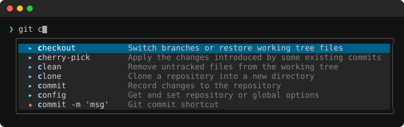

<p align="center">
  
</p>

<h1 align="center">Lig</h1>

<p align="center">
  <b>IDE-style autocomplete for your terminal.</b><br>
  Subcommands, options, branches, packages and paths in a popup as you type.<br>
  zsh, bash, fish, nushell, PowerShell and cmd, on Linux, macOS and Windows. Written in Rust.
</p>

<p align="center">
  <a href="https://github.com/KevenGoncalves/lig/releases/latest"></a>
  <a href="LICENSE"></a>
</p>

<p align="center">
  
</p>

## What is Lig?

Your shell completes with `Tab`, as a flat list of words. Lig shows a popup under the cursor
while you type, like a code editor: what each subcommand and option does, values from your
system, and the next thing that fits on the line. It brings [Fig](https://github.com/withfig/autocomplete)'s
experience to any terminal, as a single binary that draws the popup inside the terminal
itself.

- **~740 commands** out of the box (git, docker, kubectl, cargo, npm, aws, gh, terraform…),
  from the [withfig/autocomplete](https://github.com/withfig/autocomplete) specs and
  hand-written ones; any other command is read from its `--help`.
- **Live values**: git branches, containers, systemd units, ssh hosts, make targets, npm
  scripts, processes…, and **package search** on npm, crates.io, Docker Hub, PyPI, Snap and Flathub.
- Knows your **aliases, functions and variables** (`gco ` completes like `git checkout `,
  `$HO` → `$HOME`).
- **History** on `Ctrl+R`: the commands that worked, from every session, fuzzy-searched.
- Works in **any terminal**, in **tmux** and **zellij**, and on a server with **`lig ssh`**.
- Themes, Nerd Font icons, any keys. Runs locally: no daemon, no account, no telemetry.

## Try it in Docker

See Lig before installing it: the demo image opens a shell in a small git project, with
branches, a Makefile and a few files to complete. Nothing touches your system.

```bash
docker build -t lig-demo https://github.com/KevenGoncalves/lig.git
docker run --rm -it lig-demo           # zsh
docker run --rm -it lig-demo bash      # or bash, or fish
```

Start typing (`git checkout `, `make `, `cd `): the popup opens under the cursor. `Enter`
accepts, `Tab` and the arrows move, `Esc` closes, and `exit` ends the container. The first build
compiles Lig, so it takes a few minutes; `docker build -t lig-demo .` builds it from a clone.

## Install

| System | Command |
| --- | --- |
| Linux, macOS | `curl -fsSL https://github.com/KevenGoncalves/lig/releases/latest/download/install.sh \| sh` |
| Homebrew | `brew install kevengoncalves/tap/lig` |
| Fedora, RHEL | `sudo dnf copr enable kevengoncalves/lig && sudo dnf install lig` |
| Debian, Ubuntu | see [APT](#debian-ubuntu-apt) below |
| Windows | `irm https://github.com/KevenGoncalves/lig/releases/latest/download/install.ps1 \| iex` |
| Nix | see [Nix](#nix) below |
| From source | `cargo install --path .` in a clone (Rust 1.85+) |

Then turn it on in your shell and open a new terminal:

```bash
lig install            # your shell; or: lig install zsh / bash / fish / nu / pwsh / powershell
lig doctor             # check the setup
```

**Requirements**: Linux or macOS 11+ with zsh ≥ 5.3, bash ≥ 4.4 (on macOS, not Apple's 3.2),
fish ≥ 4.2.1 or nushell (tested with 0.117); Windows 10 1809+ with PowerShell or cmd.
Optional: `curl` for package search, a [Nerd Font](https://www.nerdfonts.com) for icons.

`lig install` adds a few lines to your shell's config file (`~/.zshrc`, `~/.bashrc`,
`config.fish`, `config.nu` or the PowerShell profile), backing it up first; to add them
yourself, see [Set up a shell by hand](#set-up-a-shell-by-hand).
Prebuilt archives, `.deb` and `.rpm` files are on the
[releases page](https://github.com/KevenGoncalves/lig/releases/latest).

### Debian, Ubuntu (APT)

```bash
sudo install -d /etc/apt/keyrings
curl -fsSL https://kevengoncalves.github.io/lig/apt/lig.gpg | sudo tee /etc/apt/keyrings/lig.gpg >/dev/null
echo "deb [signed-by=/etc/apt/keyrings/lig.gpg] https://kevengoncalves.github.io/lig/apt stable main" | sudo tee /etc/apt/sources.list.d/lig.list
sudo apt update && sudo apt install lig
```

### Windows

The install script puts `lig.exe` in `%LOCALAPPDATA%\Programs\lig` and on your `PATH`.

- **PowerShell**: `lig install` (PowerShell 7) or `lig install powershell` (5.1) starts
  PowerShell inside Lig from your profile; scripts and other hosts (VS Code) start as usual.
- **cmd** has no config file: `lig install cmd` adds a "Command Prompt (lig)" profile to
  Windows Terminal.
- In any other terminal, run `lig shell --shell pwsh` (or `powershell`, `cmd`) as its command.

### Set up a shell by hand

If you keep your dotfiles yourself, add the lines `lig install` would. Each shell gets two
blocks: the `pre` one goes at the **top** of the file, as it restarts the shell inside Lig
(anything above it runs twice); the `post` one goes at the **end**, after your plugins and
prompt, and connects the shell to the popup. Keep the marker comments: `lig doctor` and
`lig uninstall` look for them. `lig` must be on your `PATH` (or write its full path).

**zsh**, in `~/.zshrc`:

```zsh
# >>> lig pre >>>
eval "$(lig init zsh pre)"
# <<< lig pre <<<

# ... the rest of your config ...

# >>> lig post >>>
eval "$(lig init zsh post)"
# <<< lig post <<<
```

**bash**, in `~/.bashrc`:

```bash
# >>> lig pre >>>
eval "$(lig init bash pre)"
# <<< lig pre <<<

# ... the rest of your config ...

# >>> lig post >>>
eval "$(lig init bash post)"
# <<< lig post <<<
```

**fish**, in `~/.config/fish/config.fish`:

```fish
# >>> lig pre >>>
eval (lig init fish pre | string collect)
# <<< lig pre <<<

# ... the rest of your config ...

# >>> lig post >>>
eval (lig init fish post | string collect)
# <<< lig post <<<
```

**nushell** can't eval a command's output, so write the code to two files once (and again
after updating Lig):

```nu
lig init nu pre | save -f ($nu.default-config-dir | path join lig-pre.nu)
lig init nu post | save -f ($nu.default-config-dir | path join lig-post.nu)
```

then source them in `config.nu` (`$nu.config-path`):

```nu
# >>> lig pre >>>
source ($nu.default-config-dir | path join lig-pre.nu)
# <<< lig pre <<<

# ... the rest of your config ...

# >>> lig post >>>
source ($nu.default-config-dir | path join lig-post.nu)
# <<< lig post <<<
```

**PowerShell**, at the top of `$PROFILE` (Lig loads the rest itself; `powershell` in place of
`pwsh` for 5.1):

```powershell
# >>> lig pre >>>
Invoke-Expression (& lig init pwsh pre | Out-String)
# <<< lig pre <<<
```

- **bash on macOS**: terminals start a login shell, which reads `~/.bash_profile` and not
  `~/.bashrc`; make it read both with `[ -r ~/.bashrc ] && . ~/.bashrc` in `~/.bash_profile`.
- **nu** stops at startup if a sourced file is missing: write both files before adding the
  lines. (`lig install nu` puts the code itself in `config.nu` instead.)
- **cmd** reads no config file: run `lig shell --shell cmd.exe` as the terminal's command.
- To see exactly what runs, print it: `lig init zsh pre` (or `post`).

### Nix

The flake has a [home-manager](https://github.com/nix-community/home-manager) module that
installs Lig, writes its config and sets up your shells (no `lig install` needed):

```nix
# flake.nix
inputs.lig = { url = "github:KevenGoncalves/lig"; inputs.nixpkgs.follows = "nixpkgs"; };
```

```nix
# home.nix
{ inputs, ... }:
{
  imports = [ inputs.lig.homeModules.default ];
  programs.lig = {
    enable = true;
    settings.ui.theme = "catppuccin";   # written to ~/.config/lig/config.toml
  };
}
```

## Usage

Type as usual; the popup shows what fits.

| Key | Action |
| --- | --- |
| `Tab` / `↓` | next suggestion |
| `Shift-Tab` / `↑` | previous suggestion (on the first one: close the popup) |
| `Enter` | accept the suggestion |
| `Esc` | close the popup |
| `Ctrl+Space` | open or close the popup on demand |
| `Ctrl+R` | your history: past commands matching what's typed |

- **`Enter`** completes the word you're typing (`go bui` → `go build`) or picks the first
  suggestion after a space. On a word that's already complete (`git status`) it runs the
  line, so `Enter` `Enter` means "pick, then run".
- **Command names** don't pop up by themselves, so simple commands run with one `Enter`.
  `Ctrl+Space` shows them; `complete_commands = true` always does.
- **Folders** (`cd`, `mkdir`…) keep the popup open with the subfolders, with **↵ Enter** to
  run the line and **Back** to go up.
- **File commands** (`ls`, `cp`, `mv`, `rm`…) show their files first and their options once
  you type `-` (`options_after_dash`).
- **History** (`Ctrl+R`) lists the commands that ran without error, in every Lig session,
  newest first and each once; typing narrows it (fuzzy), and `Enter` puts one on the line.
  It starts with what zsh, bash, fish and nu remember. A command typed with a leading space
  isn't kept; `history = false` keeps nothing and leaves `Ctrl+R` to the shell.
- **Your shell's own keys stay yours**: history with the arrows, `Tab` once the popup is
  closed, fzf's `Ctrl+T`. Typing brings the popup back.

## Configuration

Settings live in `~/.config/lig/config.toml`. `lig config` prints every option with its
default; the common ones:

```toml
[ui]
theme = "default"          # catppuccin, nord, dracula, gruvbox, tokyonight, light, terminal
border = "rounded"         # square, none
icons = "auto"             # nerd, unicode, none
height = 8                 # max rows, or "30%"

[keys]                     # `lig keys` shows any key's name
accept = ["enter"]
next = ["tab", "down", "ctrl-n"]
toggle = ["ctrl-space"]
history = ["ctrl-r"]

[behavior]
enter_accepts = "auto"     # "always", "after-space", "never"
enter_runs_commands = []   # Enter picks and runs in one press, e.g. ["z", "zi"] (zsh, bash)
complete_commands = false  # pop up for command names too
options_after_dash = ["ls", "cp", "mv", "rm"]  # options only after -; "*" for all
online = true              # search package registries as you type
history = true             # keep the commands that ran, for Ctrl+R
completers = []            # for commands with no spec: ["shell", "argc"], see below
disabled_commands = []     # never show the popup for these

[colors]                   # change any of the theme's: "#rrggbb", a 256-color number, "default"
selected_bg = "#45475a"
match_fg = "214"           # also bg, fg, selected_fg, description_fg, border_fg, scrollbar_fg…

[icons]                    # `lig icons` lists the names
folder = "📁"              # a glyph,
git-branch = { color = "208" }               # a color,
"*.rs" = { glyph = "🦀", color = "#dea584" }  # or both; by extension or file name too
```

Try styles without editing anything: `lig preview --all`, `lig preview --theme nord`,
`lig icons`. A new `theme` or `[colors]` shows in open tabs too, so a light/dark switcher can
rewrite them; other settings apply to new terminal tabs.

## Your own specs

Lig looks for a command's suggestions in your specs (`~/.config/lig/specs/`), then the
built-in ones, then the command's `--help` or man page (`/?` on Windows). To change a command
Lig knows, start from its spec:

```bash
lig specs new docker       # writes docker.json in your specs folder; edit it from there
```

Lig never runs a shell script's `--help` by itself: a script could ignore it and just run.
`lig specs new` does, for the script you name and its subcommands, and lists each one it reads.

A new command takes a small file in Fig's spec format (all of it, as Lig reads it:
[docs/specs.md](docs/specs.md)), e.g. `deploy.toml`:

```toml
name = "deploy"
description = "Deploy the app"

[[options]]
name = ["-e", "--env"]
args = { name = "env", suggestions = ["staging", "production"] }

[[subcommands]]
name = "logs"
args = { name = "service", generators = { script = ["deploy", "list-services"] } }
```

For a command with no spec, Lig reads its `--help`. `completers` asks others first, in order:
`"shell"` takes what your shell's own Tab offers (zsh's completion system, fish's completions),
and `"argc"` the [argc-completions](https://github.com/sigoden/argc-completions) scripts once
they're set up in your shell.

An alias completes as the command it runs (`gco` as `git checkout`), unless it has a spec of
its own: with `alias ls=eza`, an `ls.toml` makes `ls` complete from it and `eza` from eza's.

`lig specs check` reports mistakes, `lig complete "deploy -e "` shows the suggestions, and
`lig specs generators` lists the built-in live values (`generators = [{ builtin = "git:branches" }]`).

## tmux, zellij and ssh

- Lig shows the program running in a pane, and its folder, as its own: tmux, WezTerm and
  `ps -t` see `nvim` or `claude` where you work, not `lig shell` (editor plugins that find
  a coding agent by its pane need this). `LIG_NO_MIRROR=1` turns it off.
- **tmux**: works as is.
- **zellij**: session resurrection brings each pane back as its app in the right folder, not
  as `lig shell`. On macOS this needs a zellij with `action set-resurrect-command` (newer
  than 0.45.1). Don't resurrect with `zellij attach --force-run-commands`: the prompt zellij
  shows for each pane is the safety net.
- **ssh**: `scp` and `rsync` complete paths on the host (`scp notes.txt pi:Doc` →
  `pi:Documents/`) when the login needs no password (a key, ssh-agent or a `ControlMaster`
  connection). `lig ssh admin@pi` logs in like `ssh` and brings the popup to the host's zsh
  or bash, installing nothing there; with a remote command it's plain `ssh`, so
  `alias ssh='lig ssh'` is safe.

## Update and remove

- **Update**: `lig update` installs the latest release (`--check` only looks). A Lig from a
  package manager updates there, and `lig update` tells you how. Open tabs keep their version.
  In nu, run `lig install nu` again afterwards (by hand: write the two files again), as its
  integration is a copy.
- **Skip it once**: `LIG_DISABLE=1 zsh`.
- **Remove**: `lig uninstall` (or `lig uninstall <shell>`), before removing a packaged Lig.

## Troubleshooting

| Problem | Try |
| --- | --- |
| No popup | `lig doctor` ("running inside lig" must be ok); open a new tab after installing. |
| Wrong or missing suggestions | `lig complete "<the line>"` shows what Lig would suggest. |
| A key does nothing | `lig keys` shows whether the key reaches Lig, and its name. |
| Outdated options for a command | `lig specs clear-cache` re-reads its `--help`. |
| No `scp host:` paths | The host needs a login without a password prompt. |
| `Ctrl+R` no longer opens my plugin (fzf, atuin…) | Lig's history has it: move it (`keys.history = ["alt-r"]`) or turn it off (`history = false`). |
| Something else | Start a shell with `LIG_LOG=1` and read `lig.log` in `~/.local/state/lig/` (Linux) or `$TMPDIR/lig/` (macOS). |

## How it works

Lig runs your shell in a pseudo-terminal and passes everything through. It keeps a model of
the screen, draws the popup under the cursor, and restores what was underneath when it
closes, which is why it works in any terminal (and on Wayland, where apps can't place
floating windows). Small shell hooks tell Lig the line: zsh reports it, bash's, nu's and
cmd's are read off the screen, fish and PowerShell answer when Lig asks. At each prompt they
also report the command that just ran and its exit status, for the history. Accepting sends
a private key that a shell function binds to edit the line. nu's own commands (`ls`, `open`,
`str replace`…) complete from nu's signatures, not from the coreutils of those names. Slow
sources run in the background, so typing never waits.

**Limitations**: bash's and nu's lines, read from the screen, can briefly confuse Lig in a
long line wrapping at the bottom of a full screen. Specs read from `--help` have no live
values. About a quarter of Fig's dynamic generators (JavaScript) couldn't be converted.

## Development

```bash
cargo test                      # unit tests, every built-in spec included
cargo build --release
python3 tests/fish_pty.py       # PTY tests (also shell_smoke, history_tmux, pane_mirror, nu_tmux, install…)
```

The PTY tests drive `target/release/lig` (or `LIG_TEST_BIN`) in real shells (nu from `PATH`
or `LIG_TEST_NU`; a missing shell is skipped). CI runs them on Linux and macOS, and an
end-to-end test in PowerShell and cmd on Windows (`tests/windows/`).
Built-in specs live in `specs/lig/` (hand-written), `specs/fig/` (generated by
`tools/update-fig-specs.sh`) and `specs/windows/`; packaging is described in
[packaging/README.md](packaging/README.md).

## Credits and license

Thanks to the contributors:

- [@ammachado](https://github.com/ammachado)
- [@aslan403](https://github.com/aslan403)
- [@jeremiasadriano](https://github.com/jeremiasadriano)
- [@mawkler](https://github.com/mawkler)
- [@mjsteinbaugh](https://github.com/mjsteinbaugh)
- [@nadelacruz-00](https://github.com/nadelacruz-00)
- [@techwizrd](https://github.com/techwizrd)
- [@xnmp](https://github.com/xnmp)

The specs in `specs/fig/` come from [withfig/autocomplete](https://github.com/withfig/autocomplete),
© Hercules Labs Inc. and contributors, MIT licensed (see [`specs/fig/LICENSE`](specs/fig/LICENSE)).
Lig is MIT licensed, see [`LICENSE`](LICENSE).
