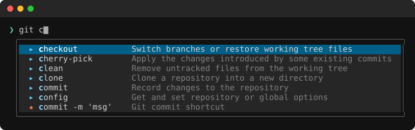

<p align="center">
  
</p>

<h1 align="center">Lig</h1>

<p align="center">
  <b>IDE-style autocomplete for your terminal.</b><br>
  Subcommands, options, branches, packages and paths in a popup as you type.<br>
  zsh, bash, fish, PowerShell and cmd, on Linux, macOS and Windows. Written in Rust.
</p>

<p align="center">
  <a href="https://github.com/KevenGoncalves/lig/releases/latest"></a>
  <a href="LICENSE"></a>
</p>

<p align="center">
  
</p>

## What is Lig?

Your shell completes with `Tab`, as a flat list of words. Lig shows a popup under the cursor
while you type, like a code editor: what each subcommand and option does, values from your
system, and the next thing that fits on the line. It brings [Fig](https://fig.io)'s
experience to any terminal, as a single binary that draws the popup inside the terminal
itself.

- **~740 commands** out of the box (git, docker, kubectl, cargo, npm, aws, gh, terraform…),
  from the [withfig/autocomplete](https://github.com/withfig/autocomplete) specs and
  hand-written ones; any other command is read from its `--help`.
- **Live values**: git branches, containers, systemd units, ssh hosts, make targets, npm
  scripts, processes…, and **package search** on npm, crates.io, Docker Hub, PyPI, Snap and Flathub.
- Knows your **aliases, functions and variables** (`gco ` completes like `git checkout `,
  `$HO` → `$HOME`).
- Works in **any terminal**, in **tmux** and **zellij**, and on a server with **`lig ssh`**.
- Themes, Nerd Font icons, any keys. Runs locally: no daemon, no account, no telemetry.

## Install

| System | Command |
| --- | --- |
| Linux, macOS | `curl -fsSL https://github.com/KevenGoncalves/lig/releases/latest/download/install.sh \| sh` |
| Homebrew | `brew install kevengoncalves/tap/lig` |
| Fedora, RHEL | `sudo dnf copr enable kevengoncalves/lig && sudo dnf install lig` |
| Debian, Ubuntu | see [APT](#debian-ubuntu-apt) below |
| Windows | `irm https://github.com/KevenGoncalves/lig/releases/latest/download/install.ps1 \| iex` |
| Nix | see [Nix](#nix) below |
| From source | `cargo install --path .` in a clone (Rust 1.85+) |

Then turn it on in your shell and open a new terminal:

```bash
lig install            # your shell; or: lig install zsh / bash / fish / pwsh / powershell
lig doctor             # check the setup
```

**Requirements**: Linux or macOS 11+ with zsh ≥ 5.3, bash ≥ 4.4 or fish ≥ 4.2.1 (on macOS,
not Apple's bash 3.2); Windows 10 1809+ with PowerShell or cmd. Optional: `curl` for
package search, a [Nerd Font](https://www.nerdfonts.com) for icons.

`lig install` adds a few lines to your shell's config file (`~/.zshrc`, `~/.bashrc`,
`config.fish` or the PowerShell profile), backing it up first.
Prebuilt archives, `.deb` and `.rpm` files are on the
[releases page](https://github.com/KevenGoncalves/lig/releases/latest).

### Debian, Ubuntu (APT)

```bash
sudo install -d /etc/apt/keyrings
curl -fsSL https://kevengoncalves.github.io/lig/apt/lig.gpg | sudo tee /etc/apt/keyrings/lig.gpg >/dev/null
echo "deb [signed-by=/etc/apt/keyrings/lig.gpg] https://kevengoncalves.github.io/lig/apt stable main" | sudo tee /etc/apt/sources.list.d/lig.list
sudo apt update && sudo apt install lig
```

### Windows

The install script puts `lig.exe` in `%LOCALAPPDATA%\Programs\lig` and on your `PATH`.

- **PowerShell**: `lig install` (PowerShell 7) or `lig install powershell` (5.1) starts
  PowerShell inside Lig from your profile; scripts and other hosts (VS Code) start as usual.
- **cmd** has no config file: `lig install cmd` adds a "Command Prompt (lig)" profile to
  Windows Terminal.
- In any other terminal, run `lig shell --shell pwsh` (or `powershell`, `cmd`) as its command.

### Nix

The flake has a [home-manager](https://github.com/nix-community/home-manager) module that
installs Lig, writes its config and sets up your shells (no `lig install` needed):

```nix
# flake.nix
inputs.lig = { url = "github:KevenGoncalves/lig"; inputs.nixpkgs.follows = "nixpkgs"; };
```

```nix
# home.nix
{ inputs, ... }:
{
  imports = [ inputs.lig.homeModules.default ];
  programs.lig = {
    enable = true;
    settings.ui.theme = "catppuccin";   # written to ~/.config/lig/config.toml
  };
}
```

## Usage

Type as usual; the popup shows what fits.

| Key | Action |
| --- | --- |
| `Tab` / `↓` | next suggestion |
| `Shift-Tab` / `↑` | previous suggestion (on the first one: close the popup) |
| `Enter` | accept the suggestion |
| `Esc` | close the popup |
| `Ctrl+Space` | open or close the popup on demand |

- **`Enter`** completes the word you're typing (`go bui` → `go build`) or picks the first
  suggestion after a space. On a word that's already complete (`git status`) it runs the
  line, so `Enter` `Enter` means "pick, then run".
- **Command names** don't pop up by themselves, so simple commands run with one `Enter`.
  `Ctrl+Space` shows them; `complete_commands = true` always does.
- **Folders** (`cd`, `mkdir`…) keep the popup open with the subfolders, with **↵ Enter** to
  run the line and **Back** to go up.
- **Your shell's own keys stay yours**: history with the arrows, `Tab` once the popup is
  closed, fzf's `Ctrl+T`. Typing brings the popup back.

## Configuration

Settings live in `~/.config/lig/config.toml`. `lig config` prints every option with its
default; the common ones:

```toml
[ui]
theme = "default"          # catppuccin, nord, dracula, gruvbox, tokyonight, light, terminal
border = "rounded"         # square, none
icons = "auto"             # nerd, unicode, none
height = 8                 # max rows, or "30%"

[keys]                     # `lig keys` shows any key's name
accept = ["enter"]
next = ["tab", "down", "ctrl-n"]
toggle = ["ctrl-space"]

[behavior]
enter_accepts = "auto"     # "always", "after-space", "never"
enter_runs_commands = []   # Enter picks and runs in one press, e.g. ["z", "zi"] (zsh, bash)
complete_commands = false  # pop up for command names too
online = true              # search package registries as you type
disabled_commands = []     # never show the popup for these
```

Try styles without editing anything: `lig preview --all`, `lig preview --theme nord`,
`lig icons`. A new `theme` or `[colors]` shows in open tabs too, so a light/dark switcher can
rewrite them; other settings apply to new terminal tabs.

## Your own specs

Lig looks for a command's suggestions in your specs (`~/.config/lig/specs/`), then the
built-in ones, then the command's `--help` or man page (`/?` on Windows). To change a command
Lig knows, start from its spec:

```bash
lig specs new docker       # writes docker.json in your specs folder; edit it from there
```

A new command takes a small file in the [Fig spec format](https://fig.io/docs/reference),
e.g. `deploy.toml`:

```toml
name = "deploy"
description = "Deploy the app"

[[options]]
name = ["-e", "--env"]
args = { name = "env", suggestions = ["staging", "production"] }

[[subcommands]]
name = "logs"
args = { name = "service", generators = { script = ["deploy", "list-services"] } }
```

`lig specs check` reports mistakes, `lig complete "deploy -e "` shows the suggestions, and
`lig specs generators` lists the built-in live values (`generators = [{ builtin = "git:branches" }]`).

## tmux, zellij and ssh

- **tmux**: works as is.
- **zellij**: on Linux, Lig shows each pane's app to zellij, so session resurrection brings
  the pane back as that app in the right folder, not as `lig shell`. On macOS this needs a
  zellij with `action set-resurrect-command` (newer than 0.45.1). `LIG_NO_MIRROR=1` turns it
  off. Don't resurrect with `zellij attach --force-run-commands`: the prompt zellij shows
  for each pane is the safety net.
- **ssh**: `scp` and `rsync` complete paths on the host (`scp notes.txt pi:Doc` →
  `pi:Documents/`) when the login needs no password (a key, ssh-agent or a `ControlMaster`
  connection). `lig ssh admin@pi` logs in like `ssh` and brings the popup to the host's zsh
  or bash, installing nothing there; with a remote command it's plain `ssh`, so
  `alias ssh='lig ssh'` is safe.

## Update and remove

- **Update**: `lig update` installs the latest release (`--check` only looks). A Lig from a
  package manager updates there, and `lig update` tells you how. Open tabs keep their version.
- **Skip it once**: `LIG_DISABLE=1 zsh`.
- **Remove**: `lig uninstall` (or `lig uninstall <shell>`), before removing a packaged Lig.

## Troubleshooting

| Problem | Try |
| --- | --- |
| No popup | `lig doctor` ("running inside lig" must be ok); open a new tab after installing. |
| Wrong or missing suggestions | `lig complete "<the line>"` shows what Lig would suggest. |
| A key does nothing | `lig keys` shows whether the key reaches Lig, and its name. |
| Outdated options for a command | `lig specs clear-cache` re-reads its `--help`. |
| No `scp host:` paths | The host needs a login without a password prompt. |
| Something else | Start a shell with `LIG_LOG=1` and read `lig.log` in `~/.local/state/lig/` (Linux) or `$TMPDIR/lig/` (macOS). |

## How it works

Lig runs your shell in a pseudo-terminal and passes everything through. It keeps a model of
the screen, draws the popup under the cursor, and restores what was underneath when it
closes, which is why it works in any terminal (and on Wayland, where apps can't place
floating windows). Small shell hooks tell Lig the line: zsh reports it, bash's and cmd's are
read off the screen, fish and PowerShell answer when Lig asks. Accepting sends a private key
that a shell function binds to edit the line. Slow sources run in the background, so typing
never waits.

**Limitations**: bash's line, read from the screen, can briefly confuse Lig in a long line
wrapping at the bottom of a full screen. Specs read from `--help` have no live values. About
a quarter of Fig's dynamic generators (JavaScript) couldn't be converted.

## Development

```bash
cargo test                      # unit tests, every built-in spec included
cargo build --release
python3 tests/fish_pty.py       # PTY tests (also shell_smoke, tmux_placement, zellij_mirror, install…)
```

The PTY tests drive `target/release/lig` (or `LIG_TEST_BIN`) in real shells; CI runs them on
Linux and macOS, and an end-to-end test in PowerShell and cmd on Windows (`tests/windows/`).
Built-in specs live in `specs/lig/` (hand-written), `specs/fig/` (generated by
`tools/update-fig-specs.sh`) and `specs/windows/`; packaging is described in
[packaging/README.md](packaging/README.md).

## Credits and license

Thanks to the contributors:
[@techwizrd](https://github.com/techwizrd) (fish support),
[@mawkler](https://github.com/mawkler) (the Nix flake and home-manager module, and several fixes),
[@nadelacruz-00](https://github.com/nadelacruz-00) (the zellij mirror),
[@jeremiasadriano](https://github.com/jeremiasadriano) (the `php` and `artisan` specs) and
[@ammachado](https://github.com/ammachado) (Apple Silicon macOS and zellij resurrection on macOS).

The specs in `specs/fig/` come from [withfig/autocomplete](https://github.com/withfig/autocomplete),
© Hercules Labs Inc. and contributors, MIT licensed (see [`specs/fig/LICENSE`](specs/fig/LICENSE)).
Lig is MIT licensed, see [`LICENSE`](LICENSE).
